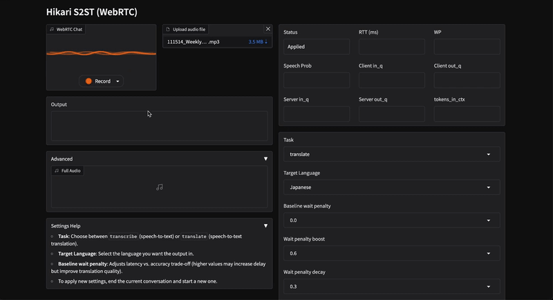

# Hikari: Simultaneous Speech-to-Text Translation

🇬🇧→🇯🇵, 🇬🇧→🇷🇺, 🇬🇧→🇩🇪 and streaming ASR

Hikari is a streaming speech-to-text translation system built on a custom Whisper variant with a fully causal encoder. It uses WebRTC for real-time browser-based interaction. Hikari currently supports English-Japanese, English-Russian and English-German language pairs as well as streaming ASR in English.



## Quick Start

Hikari has two parts: a **server** that runs the model, and a **client** (a Gradio web app) that you open in your browser. Pick the setup that matches your hardware:

| You have | Server backend | Real time? | Go to |
|---|---|---|---|
| **NVIDIA GPU** (A100 / H100 tested) | CUDA (default) | Yes, RTF ≈ 0.7 | [Option A](#option-a-nvidia-gpu) |
| **Apple silicon Mac** (M-series) | MLX (`--backend mlx`) | Only with `--refresh-stride`, see below | [Option B](#option-b-apple-silicon-mac-mlx) |
| Intel Mac, AMD GPU, CPU only | not supported | – | – |

RTF (real-time factor) is processing time divided by audio time, so **RTF < 1 means faster than real time**.

> ⚠️ **Fanless MacBook Air?** Run the server with `--refresh-stride 16` and pick context length **100** in the UI. Without it the model is about 2.5× slower than real time on an M4 Air, and the default context (337) is far slower still. Details in [Option B](#option-b-apple-silicon-mac-mlx).

### Option A: NVIDIA GPU

The server runs on the GPU machine (often a remote one); the client runs on your local machine.

**1. Install.** On both machines, create a clean environment:

```bash
uv venv .venv --python=3.10 && source .venv/bin/activate
```

On the server machine:

```bash
uv pip install torch==2.8.0 torchcodec==0.7.0 torchaudio==2.8.0 torchvision==0.23.0 --index-url https://download.pytorch.org/whl/cu126

# and then

uv pip install "hikari @ git+https://github.com/sbintuitions/hikari"
```

> 💁‍♂️ If you want to install Hikari for development
>
>```bash
>git clone https://github.com/sbintuitions/hikari.git
>cd hikari
>uv pip install torch==2.8.0 torchcodec==0.7.0 torchaudio==2.8.0 torchvision==0.23.0 --index-url https://download.pytorch.org/whl/cu126
>uv pip install -e ".[dev]"
>```

On the client machine:

```bash
uv pip install "hikari @ git+https://github.com/sbintuitions/hikari"
```

**2. Start the server** (GPU machine):

```bash
hikari-server \
    --port 4440 \
    --checkpoint sbintuitions/hikari-medium \
    --device cuda:0
```

The `--checkpoint` accepts a HuggingFace Hub ID (downloaded automatically) or a local path. The server loads the model, captures CUDA graphs for the encoder and decoder, then listens for WebSocket connections on the specified port.

**3. SSH tunnel** (only if the server is remote), so the client can reach it:

```bash
ssh -L 4440:localhost:4440 <GPU_HOST>
```

**4.** [Start the client](#start-the-client).

### Option B: Apple silicon Mac (MLX)

The model runs on the Mac's GPU through [MLX](https://github.com/ml-explore/mlx), without CUDA. Server and client both run on the same Mac, so no SSH tunnel is needed.

**1. Install** (one environment is enough for both server and client):

```bash
uv venv .venv --python=3.10 && source .venv/bin/activate
uv pip install torch==2.8.0 torchaudio==2.8.0     # plain PyPI wheels on macOS; torch is only used for the Silero VAD

uv pip install "hikari[mlx] @ git+https://github.com/sbintuitions/hikari"
```

For development, clone the repo and run `uv pip install -e ".[mlx,dev]"` instead of the last step.

**2. Start the server:**

```bash
# M-series Mac with a fan, or for the exact (reference) numerics:
hikari-server --port 4440 --checkpoint sbintuitions/hikari-medium --backend mlx

# Fanless MacBook Air (recommended there), approximate but real time:
hikari-server --port 4440 --checkpoint sbintuitions/hikari-medium --backend mlx --refresh-stride 16
```

**3.** [Start the client](#start-the-client) and **set "Decoder context length" to 100** in the UI, then click *Reset / Apply Settings*. The UI default (337) and `max` are too expensive for a Mac. The `--refresh-stride` choice is made on the server and is kept when you apply settings in the UI.

**4. Check that it keeps up.** The UI shows `Server in_q`; if that number keeps growing, the server is slower than real time. Lower the context length or use `--refresh-stride`.

#### What `--refresh-stride K` does (and what it costs)

Hikari re-encodes its whole sliding audio window every 80 ms, which a laptop GPU cannot do in real time. With `--refresh-stride K` the encoder window instead advances in blocks of K steps: it is fully re-encoded once every K steps, and in between only the newest audio is encoded on top of the cached encoder state. The decoder is still recomputed from scratch at every step (no decoder KV cache).

- **It is approximate.** Frames kept from earlier steps carry the context of the step that computed them, and the window start moves in K-step blocks. In our checks the logits stay very close to a fresh recompute (a re-encode is triggered automatically when loud speech starts, since that changes whisper's mel normalisation). We have only validated transcription on a short English clip, so check quality on your own audio and language pair before relying on it. The default mode (no flag) is the exact reference.
- **K = 16** is a good default. A smaller K refreshes more often (should be closer to exact, but is slower); a larger K is faster but lets cached frames get older. We measured speed for K = 8 and 16 only. Every K-th step takes about 2.5× longer than the others, which shows up as a small latency jitter.
- It works with the context lengths offered in the UI. Smaller contexts are cheaper still.

#### Measured speed (M4 MacBook Air, English transcription, RTF)

| Mode | Context | First minutes | After ~5 min of continuous use |
|---|---|---|---|
| exact | 100 | ≈ 2.6 | not measured |
| `--refresh-stride 16` | 100 | ≈ 0.7 | ≈ 1.0–1.3 |
| `--refresh-stride 16` | 75 | ≈ 0.65 | ≈ 1.0 |

A fanless Air heats up and throttles under sustained load, so on this machine real-time operation is **borderline for long sessions**, even though it starts well under 1. A Mac with active cooling should have more headroom (not measured). Other tips:

- **Turn off Low Power Mode.** It cuts GPU throughput by about 2.5× on an M4 Air.
- Keep the Mac plugged in and ventilated, and close other GPU-heavy apps.
- Translation costs the same as transcription (same model compute); the numbers above were measured on transcription.

Measure your own machine with `benchmarks/bench_mlx.py` (run it for at least 5 minutes, the first minute is not representative):

```bash
python benchmarks/bench_mlx.py --audio some_english.wav --window 100 --stride 16 \
    --seconds 300 --report-every 750
```

`benchmarks/run_checked.sh <command>` prints the Low Power Mode state before and after a run.

### Start the client

For now (because of the strict HPC security policies) the client must be run on your _local_ machine. In the future, the client app will be hosted in the cloud and users will connect to it from their (local) browser. 

```bash
hikari-client \
    --server-port 4440 \
    --app-port 5666 \
    --chunk-ms 80
```

Open `http://localhost:5666` in your browser.

## Requirements

**Server, NVIDIA path**
- **Python** >= 3.10
- **PyTorch** >= 2.8.0 with CUDA
- **CUDA GPU** (tested on A100, H100)

**Server, Apple silicon path**
- **Python** >= 3.10, macOS on an M-series Mac, **MLX** >= 0.31 (installed by the `mlx` extra)
- CPU **PyTorch** (only for the Silero VAD)
- Free memory for the 1.5 GB fp16 weights plus working memory

**Client** (either path): runs on CPU (macOS, Linux, Windows).

The first start needs internet access to download the checkpoint, the Silero VAD and the Whisper tokenizer.

## Supported tasks

| Task | Description |
|------|-------------|
| `transcribe` | Simultaneous speech-to-text (English) |
| `translate`  | Simultaneous speech-to-text translation (EN→JA, EN→DE, EN→RU, JA→EN) |

Tasks and parameters can be changed at runtime through the Gradio UI.

## Architecture

```
Browser (mic) ──WebRTC──▶ Gradio Client ──WebSocket──▶ Server
                                                         │
                                                Causal Whisper Encoder
                                                         │
                                                    Whisper Decoder
                                                         │
◀────────────────────────────────────────────────────── text
```

The server has two interchangeable backends with the same WebSocket interface: PyTorch/CUDA (`hikari.server.model_wrapper`) and MLX for Apple silicon (`hikari.server.model_wrapper_mlx`, model code in `src/hikari/mlx/`). To check the MLX port against the PyTorch reference, run `pytest tests/` (it needs the golden dumps produced by `benchmarks/make_reference.py`; the tests skip themselves if those are missing).

## Acknowledgements

This code was inspired by OpenAI's [Whisper](https://huggingface.co/openai/whisper-medium) and reuses code components from Kyutai's [Moshi](https://github.com/kyutai-labs/moshi).

## Citation

```
@misc{koshkin2026streamingtranslationtranscriptionspeechtotext,
      title={Streaming Translation and Transcription Through Speech-to-Text Causal Alignment}, 
      author={Roman Koshkin and Jeon Haesung and Lianbo Liu and Hao Shi and Mengjie Zhao and Yusuke Fujita and Yui Sudo},
      year={2026},
      eprint={2603.11578},
      archivePrefix={arXiv},
      primaryClass={cs.CL},
      url={https://arxiv.org/abs/2603.11578}, 
}
```
